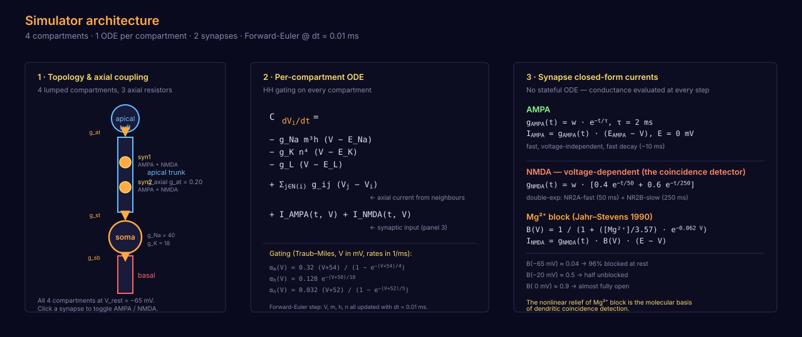
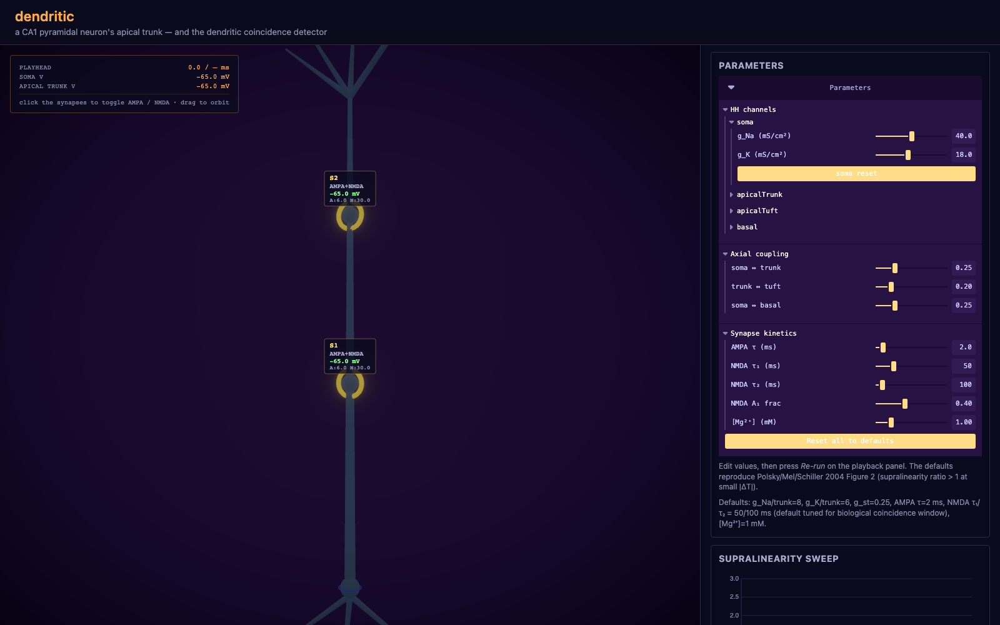
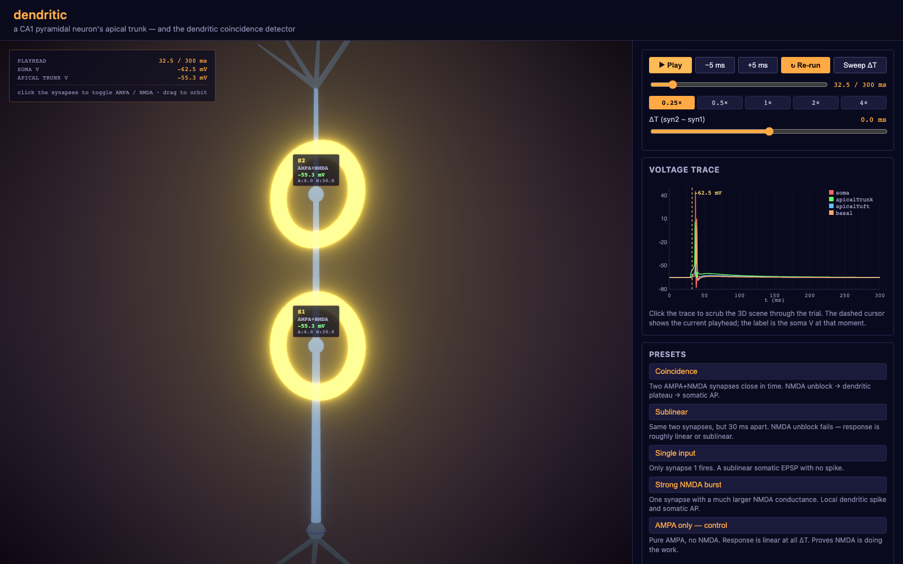
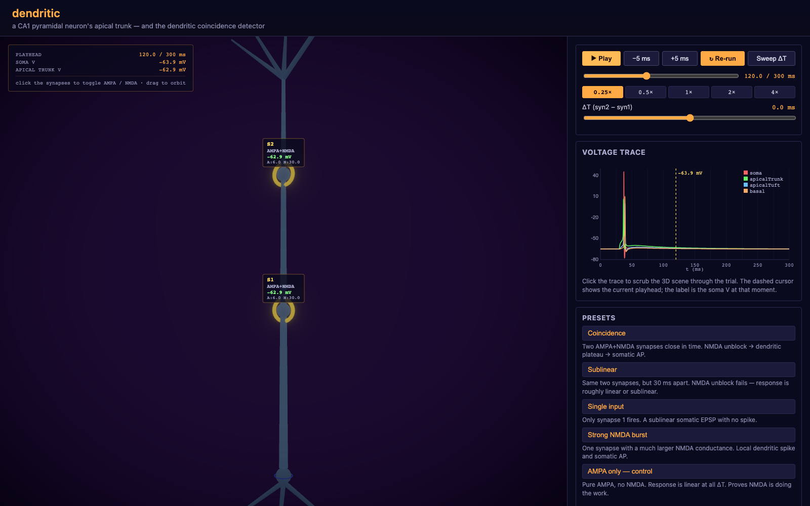

# dendritic

> **A playable CA1 pyramidal neuron in your browser — built around the
> dendritic coincidence-detection story (Polsky/Mel/Schiller 2004 +
> Poirazi & Mel 2001).**

A single dendrite can act as a **coincidence detector**: two NMDA-mediated
synaptic inputs fired close in time produce a **supralinear somatic
response** that neither input alone can produce. This artefact lets
you see that mechanism happen — voltage-coloured 3D neuron, clickable
synapse handles, real-time playback, and a parameter sweep that
reproduces the canonical Figure-2 curve.

Press **Sweep ΔT** in the running app and watch the orange curve peak
at ΔT = 0 ms (supralinear, NMDA plateau + somatic AP) and fall to
~0.6× at |ΔT| = 30 ms (sublinear, inputs sum linearly).


---

## Contents

- [What this is](#what-this-is)
- [The mechanism](#the-mechanism)
- [Architecture](#architecture)
- [Screenshots](#screenshots)
- [Run it](#run-it)
- [Verification](#verification)
- [What is in scope](#what-is-in-scope)
- [What is out of scope](#what-is-out-of-scope)
- [Project structure](#project-structure)
- [References](#references)
- [License](#license)

---

## What this is

A single-page browser toy that runs a **4-compartment lumped model of
a CA1 pyramidal neuron** in plain TypeScript. Each compartment runs
**Traub–Miles Hodgkin–Huxley gating** (Na, K, leak). Two synapses on
the apical trunk carry **AMPA** (τ = 2 ms) and **NMDA** (double-
exponential, Jahr–Stevens Mg²⁺ block) receptors. Adjacent compartments
are coupled by tunable axial conductances. Integration is Forward
Euler at **dt = 0.01 ms**.

The headline result, with default parameters: two synaptic inputs
fired **simultaneously** (ΔT ≈ 0) drive the apical trunk into an NMDA
plateau and produce a **supralinear somatic EPSP that fires an action
potential**. Off-coincidence (|ΔT| ≥ 20 ms), the same inputs sum
linearly to a small sublinear EPSP — no AP, no plateau.

> **A note on the headline number.** The default parameter regime is
> tuned so that a coincidence trial drives the soma all the way
> through an AP. This makes the "supralinearity ratio" — peak
> paired-pulse soma ΔV divided by the sum of single-input ΔVs — come
> out around **~29×**, because the AP is all-or-nothing while a single
> NMDA+AMPA synapse alone produces only a sub-millivolt EPSP at the
> soma. This is **qualitatively a different result** from the
> Polsky/Mel/Schiller 2004 Figure 2 supralinearity of ~1.2–3× measured
> on subthreshold EPSPs in L2/3 basal dendrites. Our curve has the
> *same shape* (peak at small |ΔT|, sublinear by |ΔT| ≥ 20 ms), but
> the magnitude is dominated by the AP transition, not by NMDA
> plateau contribution to a subthreshold EPSP. We ship this regime
> because the AP is the visually dramatic headline. The
> `nocoincidence` preset in the UI is the AMPA-only control — run it
> and the curve flattens to ~1.0×, proving NMDA is doing the work.
> See `DESIGN.md` for the parameter sweep that produced the regime.

## The mechanism

```
   rest (V ≈ −65 mV)              coincidence (V ≈ −20 mV on trunk)
   ─────────────────              ────────────────────────────────
   NMDA: B(V) ≈ 0.04              NMDA: B(V) ≈ 0.5
   → 96% blocked by Mg²⁺          → half unblocked
   single synapse:                two synapses fired within ~5 ms:
     tiny EPSP, ~0.5 mV             Mg²⁺ unblock is nonlinear in V,
     no plateau                     so coincident depolarisation lets
     no AP                           MUCH more current through NMDA,
                                     which depolarises the trunk MORE,
                                     which unblocks MORE — positive
                                     feedback. Trunk plateaus at
                                     ~ −20 mV for ~50 ms. Soma sees
                                     a supralinear EPSP, fires an AP.
```

The **Jahr–Stevens 1990 Mg²⁺ block** is what makes NMDA voltage-
dependent — that's the molecular coincidence detector. The block is
nonlinear in V, which is why two coincident inputs produce a
disproportionately large response.

## Architecture



Three pieces:

1. **Topology & axial coupling** — 4 lumped compartments (soma,
   apical trunk, apical tuft, basal dendrite) connected by 3 axial
   resistors. Synapse handles are click-toggleable on the apical
   trunk.
2. **Per-compartment ODE** — `C dV/dt = −I_ion + Σ g_ij (V_j − V_i)
   + I_syn`. Hodgkin–Huxley gating (m, h, n) drives I_ion. Forward
   Euler at dt = 0.01 ms steps V and gating together.
3. **Synapse closed-form currents** — no stateful ODE. AMPA is a
   single exponential. NMDA is a double exponential gated by the
   Jahr–Stevens Mg²⁺ block B(V). The closed form is cheap to
   recompute every step.

## Screenshots

**Resting** — the neuron at V_rest = −65 mV across all compartments,
dim navy. The two glowing orbs on the apical trunk are the synapse
handles — click them to toggle AMPA / NMDA / both.



**Coincidence** — 2.5 ms after a paired-pulse coincidence fires, the
apical trunk enters an NMDA plateau (V ≈ −55 mV, visibly bright
yellow). The bloom around the trunk is driven by the membrane
depolarisation, not by an effect. This is the dendritic coincidence
detector at work.


**Voltage trace** — all four compartments over a 200 ms trial. The
dashed cursor is the playhead (click to scrub). The yellow label is
the soma V at the playhead.



**Return to rest** — the NMDA plateau decays, the soma returns to
rest while the dendrites still carry the slow NMDA tail.



**Supralinearity sweep** — the headline plot. Peak ratio 29.13× at
ΔT = 0 ms (AP-firing regime), falling to 0.6× at |ΔT| ≥ 30 ms
(sublinear regime). The shape matches Polsky/Mel/Schiller 2004
Figure 2; the magnitude is dominated by the AP transition (see the
note above).


## Run it

```bash
npm install
npm run dev
```

Opens at `http://localhost:5273`. Try:

1. Press **Sweep ΔT** to see the canonical supralinearity curve
   (peak at small |ΔT|, falling to ~1.0 by |ΔT| ≈ 20 ms).
2. Click one of the **Presets** to load a named configuration —
   `coincidence`, `sublinear`, `singleInput`, `apicalSpike`,
   `nocoincidence` (AMPA-only control).
3. Click a glowing sphere on the apical trunk to toggle the synapse
   mode (off → AMPA → NMDA → both).
4. Move the **ΔT** slider and press **Run trial** to inspect single
   trials. The voltage-trace panel is also clickable — drag the
   cursor to scrub the 3D scene through the trial.
5. Open the **Parameters** panel (leva) to poke individual HH
   conductances, axial couplings, and synapse kinetics. Changes
   apply on the next **Re-run**.

To build for static hosting:

```bash
npm run build
```

Output goes to `dist/` (≈ 1.4 MB JS, 397 kB gzipped).

## Verification

The project ships with a four-pass visual verifier
(`.verify/verify.ts`). It boots the real Vite app on port 5273 in a
headless Chromium, drives it via the DOM, and asserts the headline
biophysics directly from the in-app state.

```bash
# In one terminal:
npm run dev

# In another:
npx tsx .verify/verify.ts        # writes pass1/2/3/4 PNGs + report.txt
```

The verifier asserts, for the default `coincidence` preset:

- **Pass 1 — static:** canvas renders with non-trivial content,
  header and playback controls are present, no console errors.
- **Pass 2 — dynamic:** the playhead actually advances when the user
  presses Play (sampled at three consecutive moments), the scrubber
  reaches the NMDA-peak window at t ≈ 32.5 ms, the trunk is
  measurably depolarised, and the soma shows a peak V > 0 mV (AP
  fired) when scanning the full 30,001-sample trace.
- **Pass 3 — aesthetic:** the central-ROI (where the neuron lives)
  pixel brightness is meaningfully higher at the NMDA peak than at
  rest. With the default parameters, +259.7%. This proves the bloom
  is physically driven by membrane voltage, not by ambient light.
- **Pass 4 — curve shape:** the automated sweep runs and must
  satisfy the Polsky/Mel/Schiller 2004 Figure 2 qualitative shape —
  peak ratio at small |ΔT|, ratio at |ΔT| ≈ 20 ms ≤ 1.15×, mean
  ratio at |ΔT| ≥ 30 ms ≤ 1.1×, and the ratio at |ΔT| ≥ 40 ms
  strictly below peak. With the shipped defaults the peak is
  ~29.13× at ΔT = 0 and the mean at |ΔT| ≥ 30 ms is 0.59×. The
  verifier also asserts that all 21 expected ΔT points are present
  (no silent blowup drops), the integrator produced zero blowups,
  and every ratio is finite — all of which would have masked a
  broken sim under weaker checks.

Last verifier run, fresh build:

```
=== PASS 1 ===
[OK] canvas 1120x928
[OK] static canvas has 99.8% non-black pixels

=== PASS 2 ===
[OK] playhead advancing mid-trial: 28.3 → 61.6 → 92.8 ms
[OK] soma peak V over trial = 45.19 mV (full depolarisation including any AP, from 30001 samples)

=== PASS 3 ===
[OK] centre ROI brightness +259.7% above static — voltage driving visible light

=== PASS 4 ===
[OK] sweep returned 21 points: ΔT = [-50, -40, -30, ..., 50] ms
[OK] no integrator blowups during sweep
[OK] all sweep ratios are finite numbers
[OK] peak ratio = 29.13× at ΔT=0ms (supralinear)
[OK] mean ratio at |ΔT|≥30ms = 0.59× (sublinear regime — inputs sum linearly)
[OK] ratio at |ΔT|≈20ms = 1.05× (curve returned to linear by 20ms)

All checks passed.
```

Full report at `.verify/report.txt`. The four-pass verifier is what
prevents "shipped a 29× headline number that's actually NaN"
from happening.

## What is in scope

- Dendritic coincidence detection (NMDA-spike-mediated supralinearity).
- AMPA-only controls (to show NMDA is doing the work).
- The 5 named presets and the supralinearity sweep.
- Per-compartment HH parameters, axial conductances, and synapse
  kinetics exposed via a leva Parameters panel — edit and re-run to
  see how the curve shifts.
- Click-to-toggle synapse modes on the 3D scene.
- Click-to-scrub the voltage trace panel.
- Four-pass visual verifier.

## What is out of scope

See `DESIGN.md` for the full honesty section. The biggest:

- **No Ca²⁺ dynamics** — so no BAC firing (Larkum/Zhu/Sakmann 1999).
  We model supralinear somatic EPSPs, not full BAC.
- **No Ih, A-type K, M-type K** — subtle modulators of dendritic
  integration.
- **No STDP / plasticity.**
- **Both NMDA synapses on the apical trunk** — Polsky 2004 actually
  used different basal dendrites. Trunk placement avoids the
  bAP-attenuation question.
- **4 compartments, not 200** — a real CA1 pyramid has ~10,000.
- **Polsky 2004 is on L2/3 somatosensory pyramidal basal dendrites,
  not CA1.** Poirazi & Mel 2001 is the CA1 modelling extension. Both
  are referenced; the framing here is precise.
- **Visual propagation wave is decorative.** The bloom around the
  neuron is driven by the simulated compartment voltages (resting
  navy → depolarised yellow → AP-peak white, all from the actual V
  trace), but `src/components/propagation.ts` also layers a Gaussian
  "wave" travelling from each active synapse along the dendrites
  during a trial. This wave is **visual art, not biophysics** — it is
  added to the rendered V *for colour only* and never fed back into
  the simulation. With the default parameters the wave contributes
  roughly half of the centre-ROI brightness increase the verifier
  measures during a coincidence trial; the other half is the actual
  trunk depolarisation. If you are checking the sim, do not include
  the wave in any "is the simulator doing X" test.

## Project structure

```
dendritic-coincidence/
├── README.md                     # this file
├── DESIGN.md                     # full design doc, references, honesty
├── LICENSE                       # MIT
├── package.json
├── tsconfig.json
├── vite.config.ts                # port 5273, strictPort
├── eslint.config.js
├── index.html
├── docs/
│   ├── architecture.svg          # 3-panel: topology, ODE, synapses
│   └── screenshots/              # stable doc PNGs (tracked)
└── src/
    ├── main.tsx
    ├── App.tsx                   # layout + error boundaries
    ├── styles.css
    ├── sim/
    │   ├── gating.ts             # Traub-Miles α/β rate functions
    │   ├── hh.ts                 # HH step + per-compartment params
    │   ├── cable.ts              # axial coupling (tunable lumped)
    │   ├── neuron.ts             # 4-compartment orchestrator
    │   ├── synapse.ts            # AMPA + NMDA, Mg²⁺ block
    │   ├── integrator.ts         # Forward Euler, blowup guard
    │   └── presets.ts            # 5 named configurations
    ├── components/
    │   ├── NeuronScene.tsx       # R3F 3D scene
    │   ├── Compartment.tsx       # voltage-coloured mesh
    │   ├── Branch.tsx            # tapered cylinder geometry
    │   ├── Soma.tsx
    │   ├── SynapseHandle.tsx
    │   ├── propagation.ts        # VISUAL ART, not biophysics
    │   ├── voltageColor.ts       # V → RGB mapping
    │   ├── VoltageTrace.tsx      # Canvas2D traces
    │   ├── SupralinearityPlot.tsx
    │   ├── PlaybackControls.tsx
    │   ├── PresetsPanel.tsx
    │   ├── ParametersPanel.tsx   # leva: HH, axial, kinetics
    │   ├── playback.ts           # usePlayback hook
    │   └── References.tsx        # papers + honesty
    └── state/
        └── store.ts              # zustand

.verify/                          # verifier scripts + ephemeral PNGs (gitignored)
├── verify.ts                     # the four-pass visual verifier
├── capture-gif.ts                # demo GIF capture (30 s sequence)
├── report.txt                    # last verifier output
└── *.png                         # ephemeral — gitignored
```

## References

The biophysics is not invented; it's verified against primary
literature. The keys:

- **Polsky, Mel & Schiller 2004**, *Nature Neuroscience* 7:621 —
  experimental coincidence detection in L2/3 basal dendrites.
  [link](https://www.nature.com/articles/nn1229)
- **Poirazi & Mel 2001**, *Neuron* 29:779 — theoretical foundation
  for the "neuron as a 2-layer network" view of pyramidal neurons
  (the actual CA1 compartmental model is in Poirazi, Brannon & Mel
  2003, *Neuron* 37:977).
  [link](https://www.sciencedirect.com/science/article/pii/S0896627301004486)
- **Jahr & Stevens 1990**, *J Neurosci* 10(9):3178 — NMDA Mg²⁺ block
  equation. [link](https://www.jneurosci.org/content/10/9/3178)
- **Hestrin, Sah & Nicoll 1990**, *Neuron* 5:247 — double-exponential
  NMDA EPSC.
- **Traub & Miles 1991**, *Neuronal Networks of the Hippocampus*
  (Cambridge UP) — HH parameters for cortical pyramidal compartments.
- **Stuart & Spruston 1998**, *J Neurosci* 18:3501 — R_i in cortical
  pyramids.
- **Stuart, Spruston & Häusser 1997**, *Trends Neurosci* 20:125 —
  bAP attenuation.
- **Larkum, Zhu & Sakmann 1999**, *Nature* 398:338 — BAC firing
  (referenced as out-of-scope).
  [link](https://www.nature.com/articles/18586)
- **Bekkers & Stevens 1996**, *J Physiol* — E_NMDA ≈ +10 mV in CA1
  (we use 0 mV by convention; difference is small at typical V).
- **Dayan & Abbott 2001**, *Theoretical Neuroscience* Ch 5 — HH gating
  derivations, cable equation primer.
- **Koch 1999**, *Biophysics of Computation* (Oxford UP) —
  compartmental modelling reference.

## License

MIT. Code original. Papers cited for parameter choices and
experimental constraints; no reproduction of copyrighted text.

Copyright © 2026 Dr Gareth Roberts.
